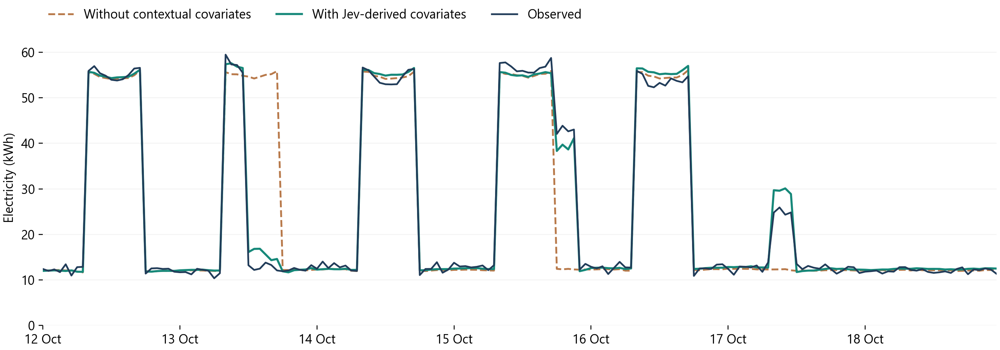
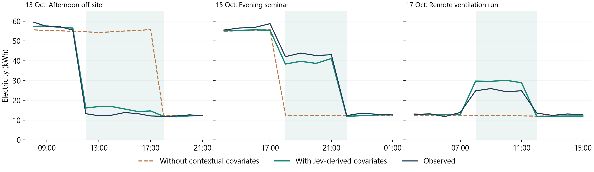

# Case study results

The completed notebook forecasts 12-18 October 2026 using the preceding eight
weeks. These are synthetic readings and original-prose operational records
prepared for the tutorial.

## What Jev interpreted

The same two questions derive occupied-zone count and ventilation state for
every time block, including the history. In the completed run, all 378 pairs of
selected values matched the authored operating states, covering 1,512 hours.

| Future event | Interpretation needed | Occupied zones | Ventilation |
|---|---|---:|---:|
| 13 October, 12:00-18:00 | A workshop moves away; all staff finish the day elsewhere; facilities switch Atlas to its out-of-hours arrangement. | 0 | 0 |
| 15 October, 18:00-22:00 | An initial whole-building booking is revised: upper-floor groups move to a separately metered annex, leaving both ground-floor rooms at Atlas. | 2 | 1 |
| 17 October, 08:00-12:00 | The technician visit is cancelled, but remote commissioning still requires ventilation. The office remains empty. | 0 | 1 |

These values are native Jev choices converted to integers. No answers were
overridden. Jev received building facts, the standing policy, the target
interval, and original records. It received no meter data, energy formula,
expected feature values, or worked examples.

The full actual request for the evening event is in
[jev_request_evening_seminar.json](results/jev_request_evening_seminar.json).
The records describe plans, rather than reporting future meter readings.

## Forecast comparison

Both calls use the same pretrained Chronos-2 revision, 1,344 historical hourly
readings, and 168-hour horizon. The baseline uses consumption only. The
contextual run additionally receives Jev-derived features for both history and
future. Future electricity consumption enters neither call.

| Forecast | Whole-week MAE, kWh | Whole-week RMSE, kWh |
|---|---:|---:|
| Without contextual covariates | 3.23 | 9.50 |
| With Jev-derived covariates | 0.99 | 1.46 |

Whole-week MAE decreased by 69.3% in this worked example.

| Event interval | MAE without context, kWh | MAE with context, kWh |
|---|---:|---:|
| Afternoon off-site | 42.08 | 2.88 |
| Evening seminar | 30.52 | 3.45 |
| Remote ventilation run | 12.69 | 4.60 |

The forecast follows the afternoon reduction, anticipates the later occupied
period, and predicts an additional weekend load while the building is empty.
Its event magnitudes remain imperfect, particularly for the ventilation run.

## How the fixture supports the example

The historical period contains 12 departures from the routine schedule, including
closures, partial occupancy, evening activities, and ventilation without
attendance. The future week varies their timing, location, or wording.
The history therefore provides examples of how these operating states relate
to consumption. Chronos-2 uses them in context; its weights are not fine-tuned.

The meter generator, event states, and all records were fixed before model
experiments. Their file hashes were checked after the completed run; the inputs
were unchanged. The generator is available in
[data/make_fixture.py](data/make_fixture.py). The notebook does not read its
authored event states.

The comparison shows the effect of making Jev-derived operational context
available to the forecaster in this example.

## Execution provenance

- Completed run: 2026-10-26T18:56:51.290274+01:00 to 2026-10-26T18:58:16.217160+01:00.
- Chronos-2 revision: 29ec3766d36d6f73f0696f85560a422f50e8498c.
- Execution device: cuda.
- Jev resolved model: typesafe/jev-1.14-20261014.
- One completed end-to-end paired forecast run, following small interface checks.
- Figure layout was polished afterward using the saved forecasts. No additional
  model calls or numerical changes were made.

Native responses and all derived features are saved with the notebook.
